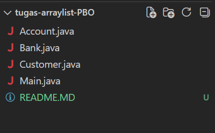
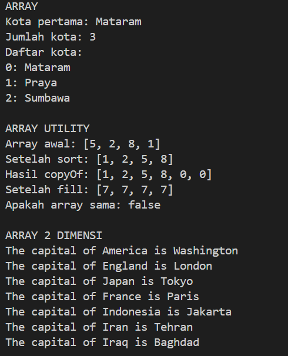
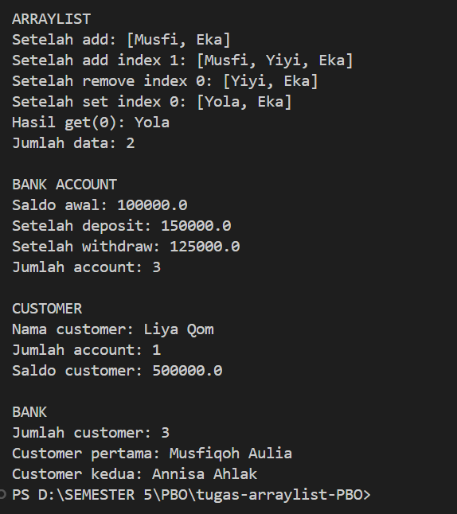

# Latihan PBO 4 - Array dan ArrayList

**NIM:** [F1D02410083]
**Nama:** [Musfiqoh Rizkia Aulia]

## Screenshot
### Struktur Project

### Hasil Program

## Informasi Tambahan

Program menggunakan library bawaan Java:

* `java.util.ArrayList`
* `java.util.Arrays`
